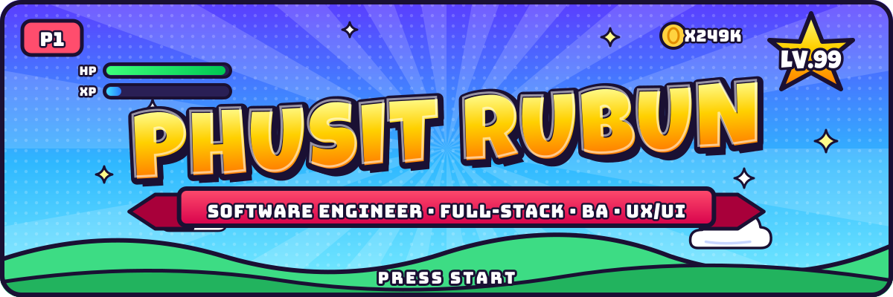

<div align="center">



<a href="https://git.io/typing-svg"></a>

<br/>

[](mailto:phusit.r56@gmail.com)


[](https://www.kuanhub.com/)

</div>

---

### 🕹️ Character Select

```ts
const phusit = {
  role:        ["Software Engineer", "Full-Stack Developer", "Business Analyst", "UX/UI Designer"],
  company:     "INET (Internet Thailand) · since Nov 2026",
  experience:  "~1 year · 5+ web & mobile projects",
  domains:     ["Government", "Education", "Welfare", "Sports", "Cultural Heritage"],
  education:   "B.Sc. Computer Science @ Mahasarakham University (2026)",
  superpower:  "Bridging the gap between what clients say and what devs build",
  currently:   "Software Engineer @ INET Thailand 🚀",
};
```

I sit where **business meets code**. I gather requirements straight from clients, map them into workflows and specs, design the UI, and when needed, build the whole thing myself from front-end to database.

---

### ⚔️ Skill Tree

<table>
<tr>
<td width="33%" valign="top">

**📋 Business Analysis**
- Requirement gathering & analysis
- Process & service workflow design
- Functional specs & UI specs
- UAT support & functional testing
- Stakeholder communication
- System docs & user manuals

</td>
<td width="33%" valign="top">

**🎨 UX / Product Design**
- User flows (Miro)
- Wireframing & prototyping
- High-fidelity UI in Figma
- Phased delivery with client review cycles

</td>
<td width="33%" valign="top">

**⚙️ Engineering**
- Full-stack web apps
- REST APIs & database design
- Auth & role-based access control
- LINE Login / OA / LIFF integration
- GIS / interactive mapping

</td>
</tr>
</table>

---

### 🎒 Inventory

<div align="center">

**Languages & Frameworks**<br/>


**Data & Backend**<br/>


**Design & Workflow**<br/>


</div>

---

### 🏆 Quest Log

<table>
<tr>
<td width="50%" valign="top">

#### 🏸 [KuanHub](https://www.kuanhub.com/) - Personal SaaS
`Next.js` `Supabase` `PostgreSQL` `LINE` `PromptPay`

My own SaaS for running casual badminton groups: check-in, live court queues, **MMR-based auto matchmaking**, scoring and per-player billing. Grew from a tool I built for a real court into a product with subscription plans.

- 🟢 **Live in production** · 7-8 months of real use, 12+ sessions / month
- 💰 **THB 249,000+** in tracked player payments
- 🏆 Rankings, seasons, achievements & QR group invites

[](https://www.kuanhub.com/)

</td>
<td width="50%" valign="top">

#### 🏛️ Digital Heritage Platform
`Next.js` `Supabase` `PostgreSQL` `GIS`

Cultural heritage documentation platform with a multi-step field survey workflow, interactive GIS mapping and role-based access control.

- 💼 **Freelance project worth THB 100,000+**
- 🗺️ Interactive map-based data exploration
- 🔐 Multi-role permissions

</td>
</tr>
<tr>
<td width="50%" valign="top">

#### 🧓 Elderly Fitness App
`Full-Stack` `LINE Login / OA / LIFF`

Fitness application for elderly users, built end-to-end from UI to database, with seamless LINE integration so users never leave the app they already know.

</td>
<td width="50%" valign="top">

#### 🏢 Client Projects @ Terminal 8
`Business Analysis` `UX/UI` `Front-End`

Requirements, user flows and UI specs for a **government back-office system**, a **university inventory system**, a **pet care app** and a **welfare platform**.

</td>
</tr>
</table>

---

### 📊 Player Stats



---

<div align="center">

### 🤝 Got a quest? Let's team up.

[](mailto:phusit.r56@gmail.com)
[](https://www.kuanhub.com/)

<br/>

<a href="mailto:phusit.r56@gmail.com"></a>

</div>
